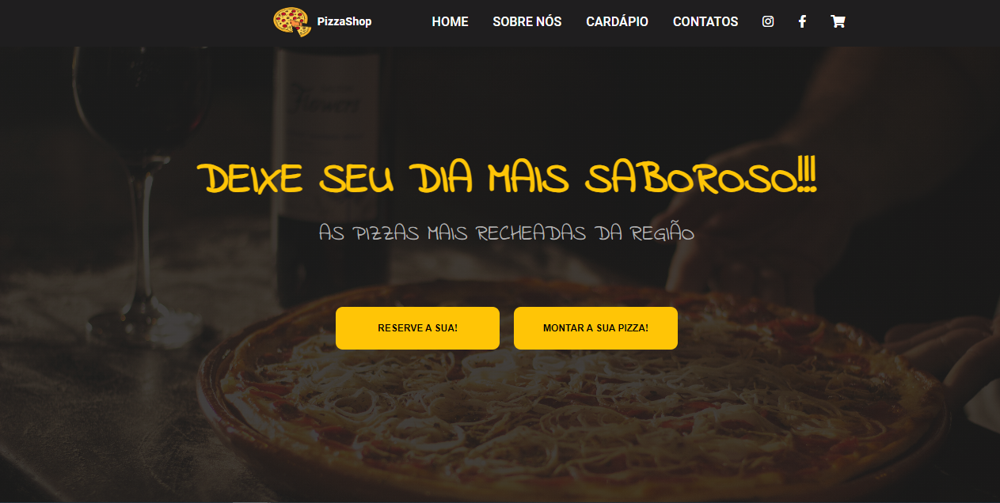

# Cardápio Digital | PizzaShop

Projeto de estudo de uma página para pizzaria, desenvolvido durante o curso de Desenvolvimento Full Stack da Infinity School, sob orientação do professor Luan Oliveira.



## O que a página apresenta

- Navegação entre início, sobre nós, cardápio e contatos.
- Oito opções de pizza, com preços por quantidade de fatias.
- Seções com imagens, apresentação do estabelecimento e contatos.
- Estilos com ajustes para diferentes larguras de tela.

O projeto exercita a estruturação de páginas em HTML e a construção de layouts com CSS. A página principal é uma demonstração visual: os botões de pedido, reserva e montagem de pizza não possuem um fluxo de compra implementado nesse arquivo.

## Tecnologias

| Tecnologia | Uso |
| --- | --- |
| HTML5 | Estrutura e conteúdo da página |
| CSS3 | Layout, apresentação e media queries |
| Font Awesome | Ícones carregados por serviço externo |
| Google Fonts | Fontes utilizadas nos estilos |

## Como visualizar

1. Clone o repositório:

   ```bash
   git clone https://github.com/alvesvslucas/Cardapiodigital.git
   ```

2. Abra a pasta e o arquivo `index.html` no navegador. Também é possível servir a pasta com um servidor local de arquivos estáticos.

A página principal pode ser aberta sem instalação de dependências. Os ícones e as fontes externas precisam de conexão com a internet.

## Arquivos principais

- `index.html` — página principal
- `style.css` — estilos e ajustes de layout
- `img/` — imagens do projeto e captura de apresentação

## Créditos

- Desenvolvido como atividade do curso da [Infinity School](https://infinityschool.com.br/).
- Orientação: [Luan Oliveira](https://www.linkedin.com/in/luanpdd/).
- Repositório mantido por [Lucas Alves](https://github.com/alvesvslucas).

[Conheça meu perfil profissional](https://github.com/alvesvslucas) · [LinkedIn](https://www.linkedin.com/in/alvesvslucas/)
